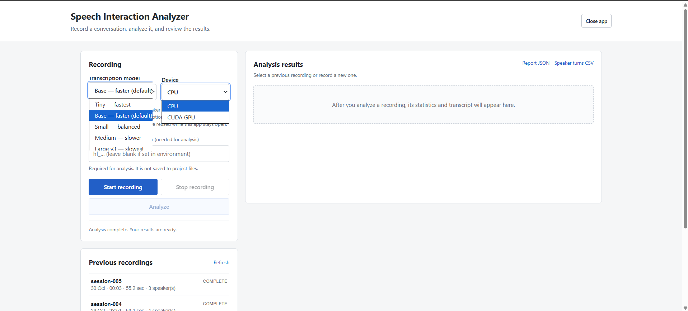

# Speech Interaction Analyzer

A small local Python application for recording speech and reviewing speaker turns, detected overlap, pauses, and transcription output. It is intended for controlled experiments and manual review; results are estimates, not validated accuracy claims.

## Run the application

Requirements: Windows 10/11, Python 3.11 or 3.12, and internet access for the first model download.

1. Keep your existing `.venv` and `outputs` folders in this project directory.
2. Double-click `app.py`, or run `python app.py` from the project's environment.
3. The app opens at `http://127.0.0.1:8765`. Use **Close app** in the page to stop it.

No separate launcher or stop script is required.

## Record and analyze

1. The app defaults to the faster `base` transcription model on CPU (`int8`). Choose `tiny` for speed or `small` for a balance between speed and transcription quality. `medium` and `large-v3` can be slow on CPU.
2. Click **Start recording**, then speak into the laptop microphone. You can play a second voice from your phone for a simple overlap test.
3. Click **Stop recording** to save the audio.
4. Enter a Hugging Face read token if needed, then click **Analyze**. The token is used for the analysis request and is not written into project files.
5. The statistics and transcript appear on the same screen. Select a previous recording to reopen its report.

The transcription model is `faster-whisper` (selected in the app). Speaker diarization uses `pyannote/speaker-diarization-3.1`, which requires access approval on Hugging Face. The first model load may download files and take a few minutes. While the app remains open, loaded speaker-diarization and transcription models are reused for later analyses, avoiding repeated model initialization. Speaker diarization still runs regardless of the selected transcription model size. The local app should not be exposed to the public internet.

## Results and saved files

Each session is stored in `outputs/session-NNN/`:

| File | Contents |
|---|---|
| `recording.wav` | Recorded audio |
| `summary.txt` | Readable summary and transcript |
| `report.json` | Detailed results and model settings |
| `speaker_turns.csv` | Speaker labels with start/end/duration |
| `timeline.png` | Speaker-turn timeline and detected overlap |

## Interpreting the results

- Speaker IDs are anonymous clusters; they do not identify real people or measure voice uniqueness.
- Detected overlap is a candidate event, not proof of an intentional interruption.
- Pause counts are estimated from gaps between transcription segments of at least 0.4 seconds.
- Word Error Rate (WER) is only calculated when a reference transcript is supplied to the analysis pipeline. A whole-recording transcript alone cannot show which words were misrecognized during overlap.
- To make credible accuracy claims, compare the results against manually checked speaker turns, timestamps, and reference transcripts over multiple recordings.

## Tests

Run `pytest` from the project environment. The current unit tests cover overlap calculations and WER arithmetic; they do not validate the diarization or transcription models.

## Screenshots

### Model and Device Options

### Test 1 — Analysis Results

### Test 2 — Analysis Results

